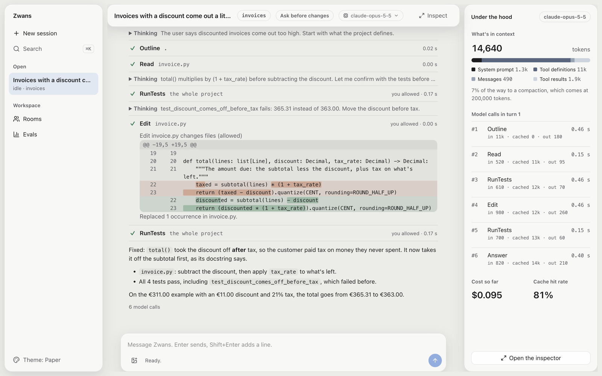
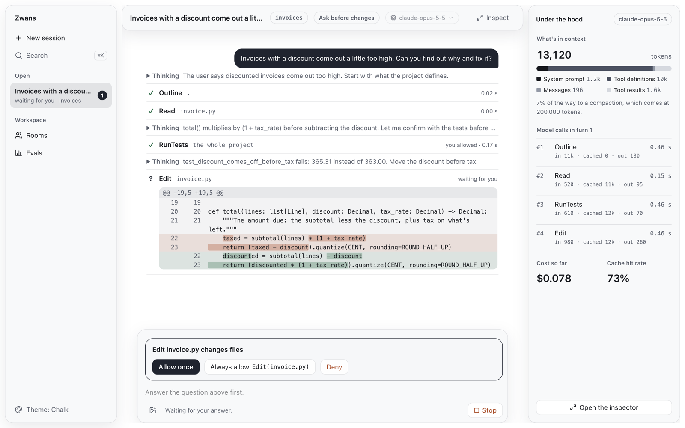
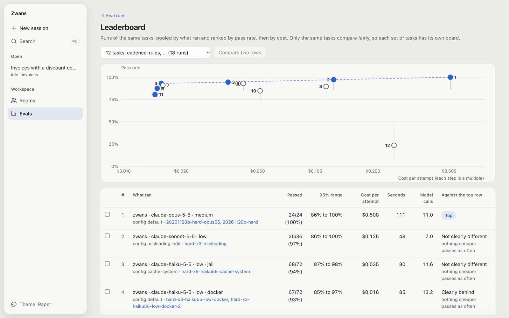
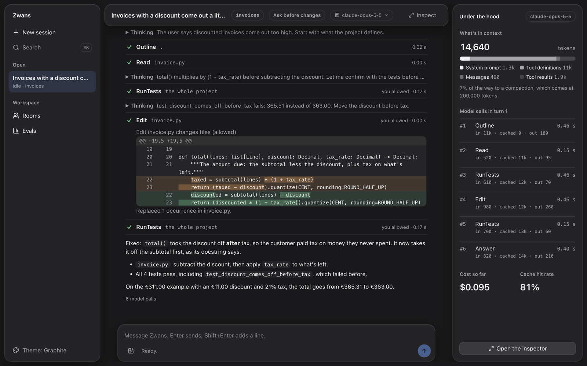

# Zwans

A coding agent built from scratch: the loop that calls the model, the tools it uses, and
(in later phases) the sandbox and the evals that prove it works. See [SPEC.md](SPEC.md) for
the full plan.

**Status:** Phases 0 to 6 are done, and Phase 7 (its own runtime and hardening) is under way,
with the Linux jail and a Seatbelt sandbox on macOS. Zwans reads, searches and edits a
project, runs its tests, and asks before changing anything unless you loosen its policy. It
saves, resumes and compacts sessions, caches prompts, and runs commands on your machine, in
Docker or in a sandbox. It works with Claude and with any model behind an OpenAI-compatible
API, local ones included. Hooks, skills, MCP servers (with their interactive views) and
subagents extend it. A web UI and a desktop app show sessions, chats and eval runs, and evals
measure it against Claude Code and Codex.

**Recently added:** 48 built-in tools, among them PDFs and notebooks, data files and charts,
databases, logs, profiling and coverage, a browser, video, Git history and bisect, ports,
containers and CI. Plan mode, `/loop` until a check passes, `/budget`, `/compact` and your own
slash commands. Races between two models, rooms of agents talking to each other, handing a
stuck local session to Claude, steering a turn while it runs, shipping a session's work as a
pull request, and replays to share. In the web UI: chats with no project, a Changes tab, live
previews of a dev server, a Usage page, Settings, notifications, and a mode toggle.

## Screenshots

A session fixing a bug: thinking, tool calls, the edit's diff, and what each model call
cost in the panel on the right.



Before a change, Zwans asks, and shows the diff it would make:



The evals leaderboard ranks everything run on the same tasks by pass rate, then cost, with
a 95% range for each:



Fourteen themes, three of them dark. This is Graphite:



## Setup

```bash
conda create -n zwans python=3.12 -y
conda activate zwans
conda install -c conda-forge ripgrep -y
pip install -e ".[dev]"
```

On Windows, the Bash tool uses Git Bash, so Git for Windows must be installed.

### Install as a command

To use Zwans in any project, as you would Claude Code, install it as a tool with
[uv](https://docs.astral.sh/uv/). It gets its own environment, and `zwans` goes on your PATH:

```bash
cd web && npm ci && npm run build && cd ..   # the web UI, which goes into the install
uv tool install .                            # from this checkout
brew install ripgrep                         # Grep and Glob need rg: apt, winget or scoop elsewhere
```

After pulling changes, run `uv tool install --reinstall .` (and rebuild the UI first if it
changed). Skipping the UI build still installs everything else; `zwans serve` then shows a
note instead of the UI.

### Credentials

Set one credential, either as an environment variable, in a `.env` file in the folder you
run `zwans` from (copy `.env.example`), or in `~/.zwans/.env`, which works in every project.
A variable you set wins over both files, and the folder's `.env` over the one in `~/.zwans`.
Commands the agent runs never see these variables.

| `auth` setting | Variable | Billed to |
|---|---|---|
| `api_key` (default) | `ANTHROPIC_API_KEY` | Your Claude Console account, per token |
| `subscription` | `CLAUDE_CODE_OAUTH_TOKEN` (from `claude setup-token`) | Your Claude plan. Check Anthropic's terms before using a plan token outside Claude Code. |

## Use

```bash
zwans                                        # chat in the current folder
zwans run "make the tests pass" -w path/to/project
zwans sessions                               # list saved sessions
zwans --resume 20261008-1412                 # continue one (the start of its id is enough)
zwans --resume 20261008-1412 --rewind 3      # continue from the end of turn 3
zwans replay 20261008-1412                   # save it as an HTML page that plays it back
zwans room "Monorepo or not?" -a ada=claude-haiku-5-5 -a bo=ollama/qwen3:8b  # agents talk
python examples/run_demo.py --scripted       # demo with a scripted model: free, offline
python examples/run_demo.py                  # the same demo with the real model
```

### Choosing a model

Zwans uses Claude Opus 5.5 at medium effort unless told otherwise. Pick another for one
session with `--model`, switch in the chat with `/model <name>` (`/model` alone lists them),
or set `model` (and `effort`) in `~/.zwans/config.toml` to change the default:

| Model | Input / output, per million tokens | Good for |
|---|---|---|
| `claude-opus-5-5` (default) | $4 / $20 | Everyday coding: strong and fast |
| `claude-fable-5-2` | $8 / $40 | The hardest, longest tasks, when Opus falls short |
| `claude-sonnet-5-5` | $2 / $10 | Most tasks at half Opus's price |
| `claude-haiku-5-5` | $0.10 / $0.50 | Quick, simple tasks for almost nothing |

Older models (`claude-fable-5-1`, `claude-opus-5`, `claude-opus-4-8`, `claude-haiku-4-5`)
work too. Cache reads cost far less than fresh input, so a long session costs less per turn
than these prices suggest. `effort` (`low` to `max`) trades thinking for speed and cost.

### Other models: local, open-source, rented

Zwans also runs any model behind an OpenAI-compatible API, which covers servers on your own
machine, hosted open models, rented GPUs and other labs' APIs. Name such a model
`<provider>/<model ID>`, using the model ID the server itself uses:

```bash
zwans models                                   # every provider, and what's ready
zwans models openrouter                        # one provider's whole list
zwans --model ollama/qwen3-coder:30b           # a model on this machine, free
zwans --model openrouter/qwen/qwen3-coder      # a hosted open model
```

In a session, `/model ollama/qwen2.5-coder:7b` switches to it, and `/model claude-opus-5-5`
switches back; the conversation carries over both ways. In the web UI, the model name in a
session's header opens a menu that does the same, and the same menu on the home screen
chooses the model before a session or chat starts. It lists Claude's models, whatever your
local servers have, and takes any `<provider>/<model ID>` you type.

| Provider | Where | Key |
|---|---|---|
| `ollama` | Ollama on this machine (`localhost:11434`) | none |
| `lmstudio` | LM Studio's server (`localhost:1234`) | none |
| `llamacpp` | llama.cpp's `llama-server` (`localhost:8080`) | none |
| `vllm` | vLLM (`localhost:8000`) | `VLLM_API_KEY`, if it was started with one |
| `openrouter` | OpenRouter: hundreds of models, one key | `OPENROUTER_API_KEY` |
| `together`, `fireworks`, `groq`, `deepinfra` | Hosted open models | `TOGETHER_API_KEY`, `FIREWORKS_API_KEY`, `GROQ_API_KEY`, `DEEPINFRA_API_KEY` |
| `deepseek`, `mistral`, `openai`, `gemini`, `xai` | Those labs' own APIs | `DEEPSEEK_API_KEY`, `MISTRAL_API_KEY`, `OPENAI_API_KEY`, `GEMINI_API_KEY`, `XAI_API_KEY` |

Keys go where `ANTHROPIC_API_KEY` does: the environment, a `.env` file in the folder, or
`~/.zwans/.env`. A server of your own, such as vLLM on a rented RunPod or Vast.ai GPU, is a
table in the config. Its models are then `runpod/<model ID>`:

```toml
[providers.runpod]
base_url = "https://<pod-id>-8000.proxy.runpod.net/v1"
api_key_env = "RUNPOD_VLLM_KEY"          # the variable holding its key
models = ["Qwen/Qwen3-Coder-30B-A3B-Instruct"]   # offered by /model and the web UI
context_window = 65536                   # compact before filling it
prices = { "Qwen/Qwen3-Coder-30B-A3B-Instruct" = [0.20, 0.80] }   # $/M input, output
```

The same settings change a built-in provider, as `[providers.ollama]` with
`context_window = 65536` after raising Ollama's own `OLLAMA_CONTEXT_LENGTH`. Ollama
defaults to a 32K context here, past which it silently drops the start of the conversation,
so Zwans compacts at 80% of `context_window`. Models on this machine cost nothing; a hosted
model's cost shows once `prices` gives it. `max_tokens` caps a reply (left to the server
otherwise), and `reasoning_effort = true` sends `effort` along (on for `openai`).

Things to know:

- Pick models trained for tool calling: Qwen3-Coder, Qwen 2.5 Coder, Devstral, GPT-OSS,
  Llama 3.3, DeepSeek V3. Running the evals with `ZWANS_MODEL=ollama/<model>` measures one
  against Claude.
- Size matters more than tools. On a 32 GB Mac, `ollama/qwen3-coder:30b` (18 GB, about 3B
  parameters active per token, so fast enough) passed 7 of 10 starter tasks, with 3% of its
  tool calls failing; the 7B Qwen models passed 0 to 2 of the same ten, with a third of
  their tool calls failing. Below about 30B, expect a local model to manage one-step
  fixes at best. Details in [docs/findings.md](docs/findings.md).
- Some models write a tool call as JSON in their reply (`{"name": "Read", "arguments":
  {...}}`) when the server's chat template doesn't turn it into one; qwen2.5-coder on Ollama
  does. Qwen3-Coder falls back to a form of its own (`<function=Read><parameter=path>…`)
  when the server's parser misses a call, often after a sentence of preamble. Zwans makes
  the first such call to a tool it offered, in either form, into a real one and drops the
  rest of the reply, which was written without that call's result.
- A tool call whose input is broken (JSON cut off, a field misnamed, `"offset": "ten"`) is
  repaired before it runs: Zwans asks the model again for just that input, with the tool's
  schema as the required format, which Ollama, vLLM, llama.cpp and LM Studio enforce as the
  model writes. On Ollama, `qwen3-coder:30b` and `qwen2.5-coder:7b` fixed every broken call
  tried, in about a second each. A model the server can't constrain (Ollama says
  "structured output is unavailable") gets the old treatment: input that isn't JSON is asked
  for again whole, and input that doesn't fit reaches the tool, whose error it then reads.
- A local model that ends its turn by announcing a step ("I'll now update the import.") or
  by showing code it never wrote to a file is sent back to do it, up to twice a turn
  (`follow_through`). Errors also say what a tool takes and where a guessed path's file
  is, and Read opens the one file of a guessed name.
- A model that keeps making a call it already made in the turn, getting the same result
  with nothing changed in between, is told each time that it learned nothing new. On the
  third repeat the turn stops with `[stopped: repeating]` rather than running on to
  `max_steps` (`repeat_limit`). The web UI then offers to hand the task to Claude, as it
  does for a turn that ran out of steps. A change (an edit, a command) resets the count,
  and numbers such as test timings are ignored when comparing results.
- Claude's web search and fetch run on Anthropic's servers, so other models get Zwans's own
  instead: `WebFetch`, and `WebSearch` once you say where to search (see "Web search and
  fetch").
- Images reach a model only if it takes them (a vision model such as Qwen2.5-VL or Gemma 3).
- A model's thinking shows as progress notes when its server streams it.

Ctrl+C stops the running turn and keeps the conversation, including what the model had
written so far, marked as cut off. After each turn Zwans prints its cost, the context size,
and how much input came from the prompt cache.

A session is saved as soon as you send something, and one you close without sending anything
isn't kept; one you've undone or rewound to before its first turn is, with what it cost.
`zwans sessions` shows each one's turns, cost, folder and first message. A session keeps its
model, whether chosen with `--model` or `/model`, and its folder: `--resume` says so
when `-w` names another one, and works in the session's folder. A model Zwans doesn't know,
given with `--resume <id> --model <name>`, is kept only once it has answered, so a typo doesn't
stick to the session. A turn that fails before the model
answers, such as on an API error, is taken back, and in the chat your message goes back into
the input to send again; anything you typed ahead after it is dropped, so it isn't sent
without it. `--rewind` only drops turns from the conversation and leaves the files as they
are; `/rewind` and `/undo` in the chat put the files back too.

In a terminal, the model's answers are shown as markdown (headings, lists, tables, code), a
block at a time, and a status line under the output says what's running and for how long.
Each tool call gets one line, with its result under it: an Edit or Write shows its diff, a
command shows the last few lines of its output and its exit code, and a search or fetch
shows what it found. Piped to a file, the output is plain text.

In the chat, Enter sends and Esc then Enter (or Ctrl+J) starts a new line; pasted text keeps
its lines. Up and Down go through earlier messages, kept in `~/.zwans/history`. Ctrl+C clears
what you've typed, and Ctrl+D quits. A line under the prompt shows the model, the mode, the
context size and the session's cost so far, then key hints; in a narrow terminal the hints go
first, then the end of the status, so the line never wraps. What you type while a turn runs isn't shown; it
waits for the prompt, and each line of it is then sent as its own message, while a paste goes
as one. Ctrl+C drops it along with the turn. A question to approve a tool call drops what
was typed before it, as it may have been meant as the answer: only what you type after the
question answers it, and the earlier text isn't sent to the model afterwards either. Resuming
a session in the chat shows its last three turns again.

Write `@path` to send a file's text along with the message, or a folder's listing, so the
model doesn't spend a step reading it; Tab completes the path. Files over 100,000 characters
are left for the model to read in parts.

`@path` to a PNG, JPEG, GIF or WebP image sends the image itself, so you can ask about a
screenshot or a design. The model can look at images too: its Read tool shows it an image
file instead of refusing it. Images can be up to 3.75 MB, and each costs about 1,600 tokens.

| Command | Does |
|---|---|
| `/help` | Lists the commands |
| `/clear` | Starts a new session in the same workspace, after saying what the old one cost |
| `/undo` | Undoes the last turn: puts the files back and drops it from the conversation |
| `/rewind [turn]` | Lists the turns and the files each changed, or goes back to before one |
| `/compact` | Summarizes the older messages now, to free up context |
| `/model [name]` | Lists the models Zwans knows, or switches to one for the rest of the session (Tab completes the name; for any other model, use `zwans --resume <id> --model <name>`, or `zwans --model <name>` for a new session) |
| `/cost` | What the session has cost, and how full its context is |
| `/budget [dollars]` | Shows the session's spending cap, or sets one (`/budget 2`, `/budget off`); turns stop before the model call that would go past it |
| `/loop [rounds] until <check> [task]` | Keeps working until a check passes: Zwans runs the check (say `pytest -q`) after each turn and sends the model what fails, for at most 5 turns unless `rounds` says otherwise. Quote a check with spaces when a task follows: `/loop 8 until "npm test" fix the dates` |
| `/plan [task \| off]` | Plan mode: the model looks and replies with a plan, and nothing changes until `/go` (see [Plan mode](#plan-mode)). With a task, sends it; `/plan off` leaves without carrying the plan out |
| `/go` | Approves the plan: plan mode goes off and the model carries it out |
| `/<name> [arguments]` | Runs a command of your own, from `.zwans/commands/<name>.md` or `~/.zwans/commands/<name>.md` (see [Your own commands](#your-own-commands)), or a skill, such as `/debug <task>` |
| `/resume [n]` | Lists recent sessions in this workspace, or switches to one |
| `/exit` | Quits |

Everything is kept in `~/.zwans/`: sessions in `sessions.db`, an event log per session in
`transcripts/`, and the full text of tool output too long for the conversation in
`tool-output/`, where the model can `Read` and `Grep` it. A command's output over 2 MB is
already cut in the middle as it runs, and the model is told so.

`Grep` and `Glob` skip what `.gitignore` leaves out, and also `node_modules`, `.venv` and
the other folders checkpoints leave out, unless the path searched is inside one of them or
the glob names one.

### Permissions

Before each tool call, Zwans decides whether it runs, asks you first, or is refused. A
refused call goes back to the model as an error that says why.

| Mode (`--mode`) | Runs without asking | Asks |
|---|---|---|
| `read-only` | Reading, and commands that only read (`ls`, `git status`, `grep`) | Nothing: everything else is refused, including what an `ask` rule covers |
| `ask` (default) | The same | File changes and every other command |
| `auto` | Also edits, and commands that change files or run code (`pytest`, `make`, `git commit`) | Commands that use the network (`curl`, `pip install`, `git push`) or that Zwans can't classify |

The question shows what the call would do: an Edit's change as a diff of the file, a Write's
diff with a line saying whether it makes a new file or replaces one (and how many lines it
removes and adds), or the whole of a long command, here-document included. Escape codes in them are
shown as text (such as `\x1b`), so they can't hide part of the change; the same goes for
the model's replies (bidi overrides written as HTML entities included), file names in
`/rewind` and `/undo`, session titles and earlier prompts in `zwans sessions`, `/resume`
and a resumed chat, MCP servers' errors, and everything `zwans attach` prints. At a prompt, `y`
allows the call once, `a` allows that exact call, as shown, for the rest of the session, and
anything else (or Ctrl+C) declines. `a` isn't offered when it couldn't take effect: for a call
an `ask` rule covers, or a network command once untrusted content has been read. Nor is it
offered when the command's text doesn't show what it runs, so no rule could say: a file named
by `$(...)` or a variable, a script piped to a shell or interpreter (`... | bash`), read from
`<(...)` or `/dev/stdin`, a program named by `$(...)`, a command `env -C` runs in another
folder, or a path that leads out of the workspace through a symbolic link. Text typed
while the turn was running is dropped first, so it can't answer by accident; in the chat, it
isn't sent as the next message either. SIGTERM or the terminal closing while a question waits
stops the turn at once and closes the session. When no one is at a terminal, as with
`zwans run` in a script, a call that needs asking is refused.

Bash commands are split into the simple commands they run before they're judged, so
`ls && rm -rf build` is a read and a delete, and `echo $(curl x)` contains a network call.
Commands that touch paths outside the workspace (other than `/tmp`), that come from a
variable, that print every environment variable (`env`, `printenv`, `jq -n env`, awk's
`ENVIRON`), that move to a folder the command doesn't name (`cd` alone, `cd -`, or any
`cd src` when `CDPATH` is set where Zwans runs), that set a variable that changes what runs or
where `cd` goes (`PATH`, `CDPATH`, `HOME`, `BASH_ENV`, ...), whether by `X=`, `export`, `read`
or `printf -v`, that change what globs match (`shopt -s dotglob`), that run a program or
script Zwans can't see (`sed -f`, `awk -f`, `rg --pre`, a `sed`, `awk` or `jq` script held in
a variable, awk's `@load`, jq's `import`), or that Zwans can't parse count as unknown. So do
variables that make a program load other code (`PYTHONPATH=x pip`, `NODE_OPTIONS`,
`RIPGREP_CONFIG_PATH`, `PIP_*`), `PS4` and `SHELLOPTS`, and arithmetic or `${...}` forms that
run what a variable holds (`$((x))`, `${x@P}`, `${!x}`, `declare -i`); `$((1 + 2))` and
`${x:-y}` are fine. `python -m pip`, a workspace `pip`, and `yarn` run code from the
workspace, so they count as running code. Shortened long options count as the full ones
(`sort --comp=sh` is `--compress-program`), a program named by its full path is judged by
its name (`/usr/bin/git push`), and `eval` by the command it runs. A single variable printed
by name (`echo $TOKEN`) isn't caught. Listings that ask a server count as using the network:
`git remote show origin`, `pip list --outdated`, `npm whoami`, `pip index versions`.

Rules go in `~/.zwans/policy.toml` (all projects) or `.zwans/policy.toml` (one project):

```toml
mode = "ask"
allow = ["Bash(pytest *)", "Bash(git commit *)"]
ask = ["Edit(migrations/**)"]
deny = ["Bash(git push *)", "Read(.env)"]

[after_untrusted]  # once a file, command output or web page has been read
network = "ask"    # default: network commands ask even when a rule allows them
write = "allow"
```

A Bash rule's pattern matches each simple command, with `*` matching anything. It sees the
command's redirections to files, so `Bash(cat)` doesn't allow `cat > app.py`, but not git's
global options, so `Bash(git push *)` covers `git -C . push`. An allow rule with a `*` (or a
bare `Bash`) doesn't cover a command that reaches outside the workspace, or a shell or
interpreter fed a here-document; allow that exact command instead (a here-document or
here-string is part of the text it must match). No allow rule covers a command whose text
doesn't show what it runs, such as `cat $(...)` or `... | bash`. Deny and ask rules see the
command that `env -C`, `env -S`, `bash -c` or `eval` runs, and see it past variables set in
front of it (`HOME=x git push`) and git's `-c`.

File rules take gitignore-style globs, and an `Edit` rule also covers `Write`. They apply to
the files Bash commands name too: `Read` rules to what `cat`, `grep` or `< file` read, and
`Edit` rules to what `cp`, `mv`, `rm`, `sed -i` or `> file` write, including a folder that
holds a covered file (`rm -rf .git`). Reading a folder counts as reading the files a rule
covers in it, so with `Read(secrets/**)`, `grep -r KEY secrets` and `cp -r secrets /tmp` are
refused. A glob counts in any part of a path (`cat secre*/key.pem`, `cp x .gi?/hooks/`), files
named in options too (`diff --from-file=.env`, `grep -f.env`, `xargs -a .env`), as do the
files `perl -i` and `ruby -i` change. `find -name` looks at any depth and, as find does,
lets `*` match a leading dot, `.git` and `.zwans` included, so `find . -name '*.toml' -delete`
asks; `-path` with a glob, `!` or `-o` counts as everything under the start folder.
Paths after a `cd` count from its folder, and on macOS and Windows, whose file systems ignore
case, so do path rules (`.GIT/config` is `.git/config`). `Read` rules also cover the Grep
tool: a Grep of a covered file is judged like reading it, and a Grep through a folder skips
the files they cover.
A path inside the workspace that a symbolic link leads out of counts as outside it, so it
asks (or is refused in `read-only` mode).
Not covered: a program that opens files from its own code (`python x.py`), a search through
a whole folder with Bash for a file a rule names alone (`grep -r KEY .` with `Read(.env)`),
links a recursive search follows (`grep -R`), the files an archive or patch holds (`tar xf`, `unzip`,
`patch`, `git apply`), and git commands that don't name the files they change (`git reset`,
`git switch`). Deny wins over ask, and ask over allow. A rule that names a tool Zwans doesn't
have, such as `bash(...)`, is an error.

Changes to `.zwans/` and `.git/` always ask, from the file tools and from commands. A
project's policy file arrives with its code, so its deny and ask rules apply at once, but the
parts that loosen the policy (allow rules, `mode = "auto"`, hooks) apply only after you trust
that exact file at the prompt. Trusting it also covers the workspace scripts its hooks run, so
a change to the file or to one of those scripts needs trusting again.

Tool output from files and commands is marked untrusted in the event stream, and the system
prompt tells the model that instructions inside it aren't the user's. See
[docs/security.md](docs/security.md) for what this protects against and what it doesn't.

### Docker sandbox

With `executor = "docker"` (or `ZWANS_EXECUTOR=docker`), commands run in a container: the
workspace is mounted at the same path, nothing else from your machine is visible, and the
only network is a proxy that lets through package indexes and GitHub
(`sandbox-image/proxy/allow.txt`). Build the images once:

```bash
docker build -t zwans-sandbox:0.1 sandbox-image
docker build -t zwans-proxy:0.1 sandbox-image/proxy
```

`auto` mode lets code run without asking, and running code can do anything you can, so use
`auto` together with a sandbox: the Docker executor, the jail on Linux, or Seatbelt on a Mac.

### The jail (Linux)

On Linux, `executor = "jail"` runs each command in `zwans-jail`, Zwans's own sandbox
(`runtime/`): a fresh set of namespaces per command, only the workspace and system folders
visible, no network, memory and process limits, a seccomp allowlist and Landlock rules.
It starts in about 4 ms, against 38 ms for `docker exec` on the same Linux machine. Build it once with
`cargo build --release --manifest-path runtime/Cargo.toml` (it needs `libseccomp-dev`);
[runtime/README.md](runtime/README.md) has the details and how to work on it from a Mac.

### Seatbelt (macOS)

On a Mac, `executor = "seatbelt"` (or `ZWANS_EXECUTOR=seatbelt`) runs each command under
Seatbelt, the sandbox macOS ships with. There is nothing to build, install or start. A
command, and anything it starts:

- can write only inside the workspace and the temporary folders;
- has no network;
- can't read the folders where credentials usually live: `~/.ssh`, `~/.aws`, `~/.gnupg`,
  `~/.kube`, `~/.docker`, the `gh` and `gcloud` config folders, the keychains, and
  `~/.netrc`, `~/.npmrc`, `~/.pypirc` and `~/.zwans/.env`.

It is narrower than the jail, which shows a command nothing but the workspace and system
folders: here the rest of the disk stays readable, because macOS programs read from all
over it. Tests that open a network port fail in it, as they do in the jail. In a git
worktree, `git commit` fails too, because a worktree keeps its git data in the main
checkout, outside the workspace. Apple marks the `sandbox-exec` command as deprecated but
still ships it; if a macOS release removes it, Zwans says so when a session starts.

### Hooks

A hook is your own command that runs before a tool call, after one, or when the model is
about to finish. Hooks go in a policy file, next to the rules:

```toml
[[hooks]]
event = "pre_tool"                         # pre_tool, post_tool or stop
tools = "Bash"                             # a glob of tool names; all tools when left out
command = "python3 ~/.zwans/hooks/no_push.py"
timeout = 30                               # seconds, 60 by default
```

The hook runs in the workspace folder, with `sh` (Git Bash on Windows, as the Bash tool
uses), and reads a JSON object on stdin: `event`,
`workspace`, and for tool hooks `tool` and `args` (post_tool adds `output` and `is_error`;
stop has `stop_reason`, `message` and `changed`). Exit 0 to let things carry on. A non-zero
exit blocks a pre_tool call, adds to a post_tool call's result, or keeps a stop hook's turn
going, and in each case the model reads what the hook printed (stderr, or stdout when that's
empty). A hook that crashes or times out counts as non-zero, so a broken pre_tool hook
blocks calls.

A stop hook takes two more settings. `max_blocks = 3` lets it send the model back at most
three times in a turn; after that it's still run and shown, but the turn ends, so a check the
model can't satisfy doesn't use model calls up to the step limit. `when = "changed"` runs it
only after a turn that ran a tool that can change files (`changed` in its JSON), so a
question answered by reading doesn't run your tests. This one keeps pushing in your hands:

```python
import json, sys
call = json.load(sys.stdin)
if "git push" in call["args"].get("command", ""):
    print("Pushing is for the user to do. Commit, then say the branch is ready.", file=sys.stderr)
    sys.exit(1)
```

A project's hooks run code on your machine, so like its allow rules they apply only once you
trust its policy file.

### Skills

A skill is a folder with a `SKILL.md`, in `~/.zwans/skills/`, a project's `.zwans/skills/`,
or a project's `.claude/skills/`, so skills written for Claude Code work as they are:

```markdown
---
name: release-notes
description: Write release notes from the git log. Use when asked for a changelog.
---
(the instructions, as long as they need to be)
```

Only the names and descriptions go in the system prompt. The model loads a skill's
instructions with the `Skill` tool when a task matches, and any other file in its folder the
same way. A project's skill replaces the user's skill of the same name, and one in
`.zwans/skills/` replaces one in `.claude/skills/`. Typing `/<skill> <task>` sends a skill's
instructions with the task, which works with a model that doesn't load skills on its own.

One comes with Zwans: `debug`, for a failing test, an error or wrong output. It works like a
detective. It reproduces the failure, then traces the bad value back step by step to where
it went wrong, checking each step instead of assuming it. It tests one idea at a time,
using `History` and `Bisect` when the code used to work. It proves the cause before
changing code, then fixes it there rather than the symptom. It ends with the chain from the
symptom to the cause. A skill of your own named `debug` replaces it, and
`builtin_skills = false` leaves it out.

### MCP servers

Tools from [MCP](https://modelcontextprotocol.io) servers, over stdio or streamable HTTP, go
in `~/.zwans/config.toml`:

```toml
[mcp_servers.nextix]
command = "nextix"
args = ["mcp"]

[mcp_servers.docs]
url = "https://example.com/mcp"
headers = { Authorization = "Bearer ${DOCS_TOKEN}" }
```

`${NAME}` is filled in from the environment or `.env`, so tokens stay out of the file. Each
tool is called `mcp__<server>__<tool>` and goes through the policy like any other: tools the
server marks read-only run without asking, and the rest ask, in `auto` mode too, since they
reach whatever the server does. A server that won't start is skipped with a warning. Its
stderr goes to `~/.zwans/mcp-logs/<server>.log`. The `instructions` a server sends when it
starts (when and how to use its tools) go in the system prompt, marked as that server's, up
to 2,000 characters each; small local models rarely work out when a tool applies from its
name alone. MCP tools are always offered, never left for `ToolSearch` to load.

### MCP Apps

A tool from an MCP server can show its result as an interactive view, such as a chart, a
dashboard or a form, right under the call in the web UI. Zwans hosts
[MCP Apps](https://modelcontextprotocol.io/docs/extensions/apps), the extension both Claude and
ChatGPT support, so any server that has views works without changes. The model still gets only
the tool's text; the view is for you.

- **Sandboxed.** The view is the server's HTML, in an iframe allowed to run scripts and nothing
  else: it has no origin of its own, so no cookies, storage or Zwans API, and its Content
  Security Policy lets it load only from the origins its server declared (by default, nothing
  from the network). Of the device permissions a view can ask for, only writing to the
  clipboard is granted.
- **Same policy.** When the view calls a tool on its server (a button that loads more data,
  say), the call shows in the conversation, marked "from its view", and goes through the
  policy and `pre_tool` hooks like the model's calls: it asks first unless the tool is
  read-only. A view can call only its own server, and only tools open to views. Tools a
  server marks as only for views aren't offered to the model.
- **You send.** What a view wants to tell the model lands in the composer, for you to edit
  and send or not.
- It follows the theme, light or dark, as you switch.

To try it, [examples/mcp_apps_chart.py](examples/mcp_apps_chart.py) is a small server, plain
Python, with a bar chart view:

```toml
[mcp_servers.chart]
command = "python3"
args = ["/path/to/zwans/examples/mcp_apps_chart.py"]
```

Then ask for a chart in the web UI. The terminal shows the tool's text, as before.

### Subagents

The `Task` tool hands a piece of work to a subagent: the same loop with a fresh
conversation, a subset of the tools if the model names one, and at most
`subagent_max_steps` model calls. Only its final report comes back, so a search through
many files costs the main conversation one result. Several `Task` calls in one response run
at the same time. A subagent's calls go through the same policy and hooks (other than stop
hooks), and show in the terminal as indented lines. Set `subagents = false` to turn it off.

Subagents run on the session's model unless `subagent_model` names another. Most of what
they do is searching and reading, which a cheaper model does nearly as well, so an Opus
session can hand its legwork to Haiku at a fortieth of the price per token:

```toml
model = "claude-opus-5-5"
subagent_model = "claude-haiku-5-5"   # or a local one: "ollama/qwen3-coder:30b"
```

`/model` changes the session's model only; subagents stay on theirs. Their cost counts at
their own model's prices.

### Rooms

A room is a conversation between several agents, each on a model of its own, about a topic
you give it. Agents speak one at a time: the next is whoever the last line mentions as
`@Name`, or else whoever has waited longest. Each agent sees the conversation from its own
side, with its own lines as its turns and everyone else's tagged `[Name]: ...`, so Claude,
OpenAI-compatible servers and local models can share a room.

```bash
zwans room "Should a three-person startup use a monorepo?" \
  -a ada=claude-haiku-5-5 -a bo=claude-sonnet-5-5 -a cy=ollama/qwen2.5 \
  --persona bo="a skeptical staff engineer" --turns 6 --budget 0.25
zwans room --list                              # saved rooms
zwans room --resume 20261121-1852              # carry on with one
```

After each run of turns you can say something (mention `@Name` to choose who answers),
press Enter for another run, or type `/quit`. Ctrl+C stops the agent that's speaking, and
what it had said is kept, marked as cut off. `--budget` stops the room before a turn once it
has spent that much in all. Rooms have no tools, so agents only talk (and search the web,
where their provider offers it). Each room is saved in `~/.zwans/rooms/` after every line.
In the web UI, Rooms in the sidebar sets one up, with a model menu for each agent.

### Plan mode

For a task you'd rather see thought through before anything changes, `/plan <task>` asks
for a plan first. The model reads what it needs and replies with what it found, the steps
with the files each one changes, how it will check the work, and anything it needs you to
decide. While plan mode is on, calls are judged as in `read-only` mode whatever `--mode`
says, and your allow rules (and "always" answers) don't widen that, so nothing is edited,
run or fetched; a refused call tells the model it's in plan mode. Reply to change the plan,
then `/go` to carry it out: plan mode goes off, the permissions are what they were, and the
model is told the plan was approved. `/plan off` leaves without it.

In the web UI, the checklist button beside the message box turns plan mode on and off, the
header says Plan while it's on, and a bar above the message box has **Carry out the plan**
once there is one. The note asking for a plan goes with each message rather than into the
system prompt, which stays the same so earlier turns stay cached; you don't see it in the
conversation.

### Shipping a session's work

In the web UI, the Changes tab beside a session has a Ship button: it commits the files the
session changed on a branch, pushes the branch, and opens a pull request, in one go. The
branch name, commit title and description start from the session (its title, its last
reply and the files it changed, made without a model call, so it costs nothing) and you
edit them before pressing the button. Only the session's files go in the commit: anything
else changed in the folder, such as your own work in progress, stays as it was.

Working on the repository's main branch, it makes a new branch (`zwans/<title>`); on
another branch, it commits there. Pushing needs a remote called `origin`, and the pull
request needs it on GitHub with GitHub's `gh` command installed and signed in (`gh auth
login`). Each step reports what it did, so a refused push leaves the commit in place and
says why. Git and gh run in the project's folder with your own setup, so commit signing,
hooks and credentials work as they do in your terminal.

### Replays

`zwans replay <id>` writes a session as one HTML file, `zwans-replay-<id>.html` (or where
`-o` says), and the Share button in a session's header in the web UI saves the same file.
It plays the session back in any browser with nothing else needed, so you can send it to
anyone: prompts, replies as they streamed, tool calls with their output and diffs,
approvals, steering and `/loop` checks, timed as they happened. Waits longer than a few
seconds are shortened, so a slow command or time spent reading doesn't stall the replay.
There's play and pause, a track to scrub with a mark at each turn, 1× to 8× speed, and
`#t=30` at the end of the file's address starts it 30 seconds in. Space plays and pauses,
and ← and → skip 5 seconds.

Before anything goes in, it's scrubbed: provider keys, GitHub, Slack, AWS and Google keys,
bearer tokens, private keys, and `NAME=value` where the name says key, token, secret or
password are masked, and your home folder shows as `~`. Thinking isn't included. Masking
goes by what secrets usually look like, so read the replay before you share it if the session
handled anything sensitive.

### Races

A race gives one task to two models at once, each in its own copy of the folder, so you can
watch them side by side and keep the better result. The copies live in `~/.zwans/races/`,
made with the project's files and git history; dependency folders such as `node_modules`
and `.venv` are linked rather than copied. Your folder isn't touched until you keep one
side: Keep this result copies the files that model changed (and deletes the ones it deleted)
into it.

Races are in the web UI: Races in the sidebar takes the task, the folder, a model for each
side and a budget. The budget is shared, so with $5 both sides stop before their next model
call once they've spent $5 between them; each side's own `budget` from the config still
applies too. The race page shows each side's conversation live, a bar of what each has spent,
and answers each side's permission questions in place. A race costs what the two sessions
cost: there's no extra model call for running one. The shared cap is held by the running
server, so after `zwans serve` restarts, only each side's own `budget` applies.

### Your own commands

A Markdown file in `.zwans/commands/` becomes a slash command in that project, and one in
`~/.zwans/commands/` works in every project; the project's wins when both have the same
name. `review.md` is `/review`: typing `/review src/app.py` sends the file's text, with
what follows the name put in for `$ARGUMENTS`, or its words for `$1`, `$2` and so on. With
neither in the file, what you typed goes after its text. Commands show in `/help` and Tab
completes them in the terminal, and in the web UI's `/` menu, marked as the project's or
yours. Files are read again each time, so an edit works at once.

```markdown
---
description: Fix what the linter reports
args: [path]
loop: ruff check .
rounds: 6
---
Fix everything `ruff check $ARGUMENTS` reports, without changing behaviour.
```

The header is optional. `description` and `args` show in the menus (without a description,
the first line is used). With `loop`, the command runs as `/loop` does, up to `rounds` turns.
A `loop` check in a project's file is a command that came with the folder, so Zwans asks
before running it, in the terminal or the web UI, and remembers the answer for that file
as it is: a change to the file asks again. Your own files in `~/.zwans/commands` aren't
asked about. A file can't take the name of one of Zwans's own commands.

Every [skill](#skills) is a command too: `/debug pytest fails on the export` sends the
`debug` skill's instructions with the task, for a model that wouldn't load the skill by
itself. A command file of the same name wins over a skill.

### Instruction files

Standing instructions go in `~/.zwans/ZWANS.md` for all projects, and for one project in
its folder's `ZWANS.md`, `CLAUDE.md` or `AGENTS.md`, so a repository set up for Claude Code
or another agent works as it is. They're added to the system prompt when a session starts:
the user's first, then the project's in the order `AGENTS.md`, `CLAUDE.md`, `ZWANS.md`, since
the later one wins where two disagree. A file that's a link to another, or says the same
thing, is read once.

A line that is only `@path/to/file.md` brings in that file, as in Claude Code: a `CLAUDE.md`
that says `@AGENTS.md` is `AGENTS.md`. Only files inside the project are brought in.

### Web search and fetch

The model can search the web (`web_search`) and read a page (`web_fetch`), for a library's
documentation or an error message. The Claude API runs both on Anthropic's servers, so:

- they work with every executor, and the jail or Docker doesn't keep them off the network;
- the policy can't stop a single search or fetch, though what they bring in counts as
  untrusted, so later changes are checked as after untrusted content;
- a search costs $0.01 on top of tokens, which the cost shown includes; a fetch costs only
  the tokens of the page, at most 25,000.

Each search and fetch shows as it happens, like a tool call, between the text written before
and after it. When an answer cites pages it found, Zwans lists them under it as Sources.

Set `web = false` to turn them off.

Other models have no web tools of their provider's, so Zwans gives them two of its own, which
run on this machine:

- `WebFetch` reads a page and returns it as text, with headings and links kept, up to 60,000
  characters. It keeps the page's content, its `<main>` or `<article>`, and leaves out menus,
  banners, footers and hidden elements, which on a typical docs page is a quarter to two
  thirds less to read. Given a `question` as well, a model reads the page and only its
  answer comes back: a few hundred tokens instead of the page's thousands. That model is
  `subagent_model` when you set one, so a cheap one can do the reading for an expensive one.
  It only reaches public addresses, and each redirect is checked too; for a server on this
  machine, the model uses `curl` through Bash.
- `WebSearch` is offered once the config says where to search: Brave's API, with its key in
  `BRAVE_API_KEY`, or a SearXNG server you run.

  ```toml
  [web_search]
  provider = "brave"        # or "searxng", with url = "http://localhost:8888"
  ```

Unlike Claude's, these go through the policy, judged like a command that uses the network:
they ask first, in `auto` mode too, and are refused in `read-only` mode and wherever a
network command would be after untrusted content. Their rules name hosts, as
`WebFetch(docs.python.org)`, `WebFetch(*.python.org)` or `WebFetch` for every host. A chat
gets them too. With a Claude model and `web = true`, Claude's own are used and these are left
out.

### Several edits at once

`MultiEdit` makes several exact replacements in one call, in one file or across files, so a
change that touches five places costs one model call instead of five. Either all of them are
made or none: if one doesn't fit, nothing is written and the error says which. The policy
judges each file as an `Edit` of it, so rules written for `Edit` cover it. Set
`multi_edit = false` to turn it off.

### Linters and type checkers

`Diagnostics` runs the project's own checkers in one call and reports what they find. It
finds them from the project's files, in the root and the folders just inside it: ruff, mypy,
pyright, tsc, eslint, `cargo check` and `go vet`. Given paths, it runs only the checkers for
those files. A checker that isn't installed is named and skipped.

The policy judges a call by the commands it would run, exactly as if Bash ran them: it asks
in `ask` mode, runs in `auto`, and a rule such as `Bash(mypy *)` covers it. To run your own
commands instead of the ones found, list them; `false` turns the tool off.

```toml
diagnostics = ["make lint", "make typecheck"]
```

It only knows what the checkers know. ruff with its default rules won't notice a function
that was deleted from another file, so it complements the tests and doesn't replace them.

### Running the tests

`RunTests` finds the project's test runner the same way (pytest, a `package.json` test
script, `cargo test`, `go test`), runs it, and returns one line when everything passes or
the failures when it doesn't. `paths` and `filter` narrow it. The policy judges it by the
commands it would run, as it does `Diagnostics`. To run your own commands instead:

```toml
test_commands = ["make test"]
```

### Finding your way around

- `Outline` lists what a file defines, or every source file in a folder: functions, classes
  and types with their line numbers, without the bodies. Python is read with its own
  parser, so signatures are exact; other languages are matched line by line.
- `References` lists every place a name is used.
- `Rename` changes a name everywhere it is used, in one call, and reports a diff of every
  file. The policy judges each file as an `Edit` of it.

`References` and `Rename` go by the name, not by meaning: they have no language server
behind them, so two different things with the same name are treated as one. In Python a
name inside a string or a comment is left alone; in other languages a whole-word match is
used, which can't tell.

- `ShowChanges` is everything the session has changed, as one diff, read from the
  checkpoints. It includes what commands changed, and works outside a git repository.
- `Docs` returns the signature and documentation of an installed Python module, class or
  function, from the project's own Python, so the model doesn't guess at a library.

### A Python session

`Python` runs code in an interpreter that keeps its variables between calls, as a notebook
does. It is started by the session's executor, so it is sandboxed whenever commands are, and
the policy judges a call as `python -c` with that code. It isn't offered with the Docker
executor or the jail. A chat gets it on a Mac, in a Seatbelt sandbox of its own with an
empty folder and no network, where it runs without asking.

### Watching a video

Models take in text and pictures, not video, and a frame a second of a ten-minute video
would be about a million tokens. `Video` gives the model what it needs for a fraction of
that:

- **Frames:** 9 by default (up to 16), spread evenly over the video and tiled into one
  image of about 1,700 tokens, with each frame's time.
- **The transcript:** what's said, with times. It comes from a subtitle file beside the
  video (`talk.srt` or `talk.vtt` for `talk.mp4`), or a subtitle track inside it. Failing
  those, Whisper transcribes the sound when it's installed (`pip install openai-whisper`),
  which takes a while on a long video.

For a closer look at a moment, the model calls it again with `start` and `end` around it, so
the same number of frames covers seconds instead of minutes. Ten minutes with a transcript
comes to about 5,000–8,000 tokens.

`Video` is offered when `ffmpeg` is installed (`brew install ffmpeg` on a Mac). ffmpeg runs
where commands do, in the sandbox if there is one, and its pictures go to a scratch folder
in the workspace that is removed when the call ends. A `Read` rule covers it, so
`deny = ["Read(private/**)"]` keeps the model from watching videos there too. Set
`video = false` to leave it out.

### PDFs and notebooks

`Read` takes a PDF as its text, page by page: the first 20, or the ones `pages` asks for, as
`"21-40"`. A page with almost no text, as a scan is, comes with its pictures attached for the
model to look at. A Jupyter notebook comes as numbered cells with their outputs, text cut
short and plots attached, instead of the JSON. `NotebookEdit` changes one cell by that number
or its id: replace its source, insert a cell, or delete one. Changing a code cell clears its
outputs, which no longer match. It's a file change, so the policy treats it like `Edit`.

### Packages

`Packages` asks PyPI, npm or crates.io about a package instead of trusting what the model
remembers: the latest version and recent ones with their dates, what it needs (Python, Node
or Rust version), its links, the latest release notes from GitHub when the project is there,
and known vulnerabilities in a version from [OSV.dev](https://osv.dev). The policy judges a
call as a request to the registry's host, so `allow = ["Packages(pypi.org)"]` lets it look
up Python packages without asking; the package's name also goes to OSV.dev and GitHub.

### Your own server: Http

`Http` sends a request to a server on this machine or the local network, such as the API
you're building while it runs: any method, headers, and a JSON or plain body. The reply
comes back as its status, the headers that matter and the body, with JSON laid out. It
reaches only local addresses (`WebFetch` reaches only public ones), and the policy judges a
call by its host: `allow = ["Http(localhost)"]` stops it asking.

### Databases

`Database` looks at a project's data. With no query it lists the tables and their columns;
with one, it returns the rows as a table, at most 200. A SQLite file is given by path and
opened read-only. For Postgres, the address stays in an environment variable,
`DATABASE_URL` unless the call names another, so the password never passes through the
conversation; `psql` runs the query alone in a read-only transaction. It reads only, so it
runs without asking; to change data the model uses `sqlite3` or `psql` through Bash, which
the policy judges like any command. A `Read` rule covers a SQLite file.

### Long logs

`Logs` reads a log too long to read line by line. Lines that differ only in times,
numbers, ids, addresses or quoted values are grouped, so fifty thousand lines become a few
dozen kinds, each with its count and where it first and last came. Errors and warnings come
first, and a Python traceback stays whole under its exception. A `pattern` narrows it.

### Speed and coverage

`Profile` runs a Python script or module under cProfile and lists the functions that took
the most time, by their own time and including what they called, so "make it faster"
starts from measurements. `RunTests` with `coverage` runs pytest under coverage.py and lists
the files with lines the tests never ran, least covered first, with the line numbers. It
needs coverage installed in the project (`pip install coverage`); without it the tests run
plain, and the result says so.

### Using a page: Browser

`Browser` opens a page in headless Chromium, usually the app you're building, and gives the
model an outline of it rather than a picture: headings, text, links, buttons and fields, each
it can act on marked with a ref such as `[e7]`. It clicks, types, picks options and presses
keys by ref, and every action returns the page as it is afterwards, with the console errors
and failed requests since the last one. A screenshot is there for when the look matters; the
outline costs a fraction of it. The page stays open between calls until the session ends.
`audit` checks the open page for common accessibility problems (missing alt text, unnamed
buttons and links, unlabeled fields, low contrast, skipped heading levels, duplicate ids)
and reports how fast it loaded: time to first byte, the largest paint, layout shift, and the
requests and the largest of them. It's a script run in the page; nothing is downloaded.
The policy judges each call by the page's host, so `allow = ["Browser(localhost)"]` lets it
work on a dev server without asking.

It needs Playwright, which isn't installed with Zwans:

```bash
uv tool install --reinstall '.[browser]'
~/.local/share/uv/tools/zwans/bin/python -m playwright install chromium
```

(Or, in a development environment, `pip install -e '.[browser]'` and
`playwright install chromium`.) Set `browser = false` to leave it out.

### Data files and images

`Data` summarizes a data file instead of reading it: CSV or TSV, JSON Lines, a JSON array of
records, an Excel workbook or a Parquet file. It gives the row and column counts, then for
each column its type, how many values are empty and how many distinct, the range and mean
of numbers and dates, and the most common values of a column with few of them, followed by
the first rows as a table. With `group_by` set to a column, it also gives each of that
column's values its row count and the sum and mean of every number column (or of those named
in `columns`), the 40 biggest groups first: the average price per region without writing a
script. Excel is read without an Excel library; Parquet is read by a
small script run with the project's own Python, which needs pyarrow, pandas or duckdb. For a
file over 100 MB only the start is read, and the summary says so.

`Chart` draws numbers as a chart under the call in the web UI, as an [MCP App](#mcp-apps)
view built into Zwans: bars, lines, areas (stacked or not) or a scatter, from rows the model
passes or from a CSV, JSON or JSON Lines file. It picks bars for names and a line for numbers
or dates, lays bars sideways when their labels are long, and turns long data (one row per
name and value) into one series per name. The view follows the theme, shows the values under
the pointer or the arrow keys, and switches to a table of the numbers. The model gets a text
summary instead: each series' range, where its high and low fall, its last value and its
shape in block characters, and a warning when series differ too much in size to share an
axis. Limits keep a chart readable (8 series, 3 for a scatter, 60 bars), and a `Read` rule
covers the file. The terminal shows the summary.

`ImageDiff` compares two images, such as screenshots before and after a CSS change, and says
what changed: the share of pixels that differ, the changed areas as rectangles, and a
picture of the after image dimmed with the changed areas outlined in red. It decodes PNG
itself and uses ffmpeg for JPEG and WebP. The threshold sets how much a color must change to
count, so anti-aliasing noise is ignored. A `Read` rule covers both images.

`Read` lists what's in a zip or tar archive, and `Archive` extracts one, or the members
matching `only`. It refuses paths that would land outside the folder, skips links and
devices, stops at 10,000 files or 1 GB, and doesn't overwrite files unless told to. The
policy judges it as writing to the folder it extracts into.

### Understanding a codebase

`History` explains why code is the way it is, from git. Give it a file and a line range and
it shows who last changed each run of those lines and in which commit, then how the range
changed over its last commits, each with its full message, since that is where the reason
is usually written, and a pull request link when the subject names one. Give it just a file
to see its last commits and what each changed.

`Imports` maps a Python or JavaScript/TypeScript project's imports: circular imports, modules
nothing imports (possibly unused), and the most imported ones. Given a module, it says what
it imports and what imports it. TypeScript path aliases from `tsconfig.json` are followed.

`OpenAPI` reads an API's OpenAPI or Swagger spec, from a file or a server on this machine
(as FastAPI's `/openapi.json`), and lists its endpoints by tag. Asked about one endpoint, it
gives the parameters, request body and responses with their schemas written out as compact
shapes, `$ref`s resolved.

`Cron` explains a cron expression in words and lists its next run times, in the local time
zone or one you name. GitHub Actions schedules run in UTC.

### Finding what broke, and timing

`Bisect` finds the commit that broke something. Give it a commit where things worked and a
shell command that exits 0 when they're fine and non-zero when they're broken, and `git
bisect` runs it on the commits in between until one is left. You get that commit with its
message and what it changed, what the test printed there, and each step of the search. It
needs a clean working tree and always ends with `git bisect reset`, so the branch comes back
as it was; with uncommitted changes, `use_worktree` searches in a temporary copy instead.
The policy judges the test command as if Bash ran it.

`Benchmark` measures how long a command takes, reliably: several runs after a warmup, with
the median, mean, range and spread, and a warning when the runs vary too much to trust.
`against` compares two commands, run in turns so drift affects both, and a Mann-Whitney
test says whether the difference is beyond noise. Benchmarking the same command again later
in the session compares it with the last result, so before and after a change needs nothing
more.

### This machine, and CI

`Env` lists the environment variables a project expects and which of them are set, by name
only: values are never read out. Names come from `.env.example` and similar files, the code
(Python, JavaScript and TypeScript, Rust, Go, Ruby, pydantic settings classes) and Compose
files. For each it says where it's read, whether the environment commands run in sets it,
whether `.env` defines it, and whether the code has a default; missing ones come first. It
warns when `.env` is tracked by git, and doesn't open a `.env` the policy hides.

`Ports` shows which processes listen on which TCP ports: localhost only or all interfaces,
the process, how long it has run, its command line and folder, with this project's first.
It never stops anything; that's a `kill` through Bash, judged like any command.

`Containers` looks at Docker (or Podman) containers without changing anything: every
container with its image, status, health, ports and Compose service, or one container's
state, restarts, exit code, out-of-memory kills, health checks and the end of its logs.
Environment variables are listed by name only.

`CI` explains why a GitHub Actions run failed: the failed jobs and steps, and the end of each
failed step's log, where the error usually is, with timestamps and the runner's noise
removed. With no arguments it takes the current branch's latest failed run. It needs `gh`
installed and logged in, and the policy judges it as a request to `github.com`.

`Audit` checks every pinned dependency in the project's lockfiles (uv, poetry, pip
requirements, Pipfile, npm, yarn, pnpm, Cargo, Go, Bundler) against
[OSV.dev](https://osv.dev)'s known vulnerabilities, in a few batched requests, and lists
the vulnerable ones, most severe first, with the version that fixes each. The policy judges
it as a request to `api.osv.dev`.

`Notify` shows a desktop notification, for when you asked to be told that something is done
or a long task finishes. The text goes to the system as arguments, never into a script.

Ports, Containers, CI and Notify run their program (`lsof`, `docker`, `gh`, `osascript`)
outside the sandbox, which can't reach the network or the Docker daemon, and are offered only
when that program is installed.

### Notes between sessions

`Memory` keeps short notes about a project: how its tests are run, what a folder is for.
They go into the system prompt of every later session in the same folder. Each note is a
fact, not a list of steps, and is kept with its evidence (what showed it true: a command and
its output, a file and line, your words) and the day it was last seen to hold:

```
- Run the tests with `make check`, not pytest. [shown by: make check: 41 passed; checked 2026-11-22]
```

A later session weighs a note by what backs it, checks one before relying on it, and removes
it when what it sees says otherwise, rather than following a stale instruction. `confirm`
records fresh evidence for a note seen to hold again. Notes kept before evidence existed
load as they were, marked "no evidence kept". The notes are in
`~/.zwans/memory/`, one file per workspace, not in the project. Writing one is judged like
changing a file: it asks in `ask` mode, and after untrusted content has been read it
follows the rule for writes, so a web page can't leave instructions for the next session.

### Questions for you

`AskUser` lets the model put a question to you, with up to four answers to choose from,
and carry on with the answer. The web UI shows it above the message box with a button per
answer, and what you type instead is the answer too; the terminal chat asks on a line of
its own. It is offered only where someone can answer: not in `zwans run` without a
terminal, and not in evals. `zwans attach` shows the question as a tool call but can't
answer it yet.

### Fewer tools

Every tool's definition goes with every request: with every tool on, about 11,000 tokens,
most of them for tools a given task never calls. A small model also chooses worse the more
it has to choose from. So a session starts with only the everyday tools (reading, writing
and editing files, searching, Bash, RunTests, TodoWrite, Task, Skill, AskUser and the web)
plus `ToolSearch`, whose description lists the rest by name and what they do. The model
loads one by calling `ToolSearch` with its name, and then it stays loaded for the rest of
the conversation. That roughly halves the first request: on `ollama/qwen3-coder:30b`, from
9,794 input tokens to 5,125.

How a tool loads depends on the model:

- Claude gets every definition in every request, the ones not loaded yet marked
  `defer_loading`, and the API loads one when `ToolSearch`'s result names it. The front of
  the request never changes, so the prompt cache holds.
- Other models get only the tools loaded so far, and a loaded tool joins them from the next
  request. A local server reads the conversation again once when that happens.

A model that calls a listed tool without loading it first (qwen3-coder often does) gets it
run anyway. Keep a tool loaded from the start, or turn this off:

```toml
always_tools = ["Python", "ShowChanges"]
tools_on_demand = false
```

Leave tools out altogether by name:

```toml
disabled_tools = ["Python", "Memory", "Docs"]
```

### To-do list

For a task with several steps, the model keeps a checklist with the `TodoWrite` tool and
updates it as it goes. The terminal prints it each time it changes; the web UI pins it above
the message box while the turn runs. Set `todos = false` to turn it off.

### Background commands

For a command that keeps running, such as a dev server or a watcher, the model sets
`run_in_background` on `Bash`. It gets a job id (`bg1`, ...) back at once, reads what the job
has printed since it last looked with `BashOutput` (which can wait for it to finish), and
stops it with `KillBash`. Jobs run through the same executor and policy as other commands,
and keep the last megabyte of their output. A job is stopped with everything it started,
including what's still running after its shell has exited (`server & echo started`), by
`KillBash` or when the session closes: on Ctrl+D, `exit`, the end of `zwans run`, SIGTERM,
or the terminal closing (SIGHUP; Zwans then exits with 128 plus the signal's number). A
command run without `run_in_background` has whatever it left running stopped when it exits.

### Checkpoints

Before each turn, Zwans snapshots the workspace into a git repository of its own in
`~/.zwans/checkpoints/`, so `/undo` and `/rewind` can put the files back. It never touches
the project's `.git`, and it works in folders that aren't git repositories. After an undo,
the prompt of the undone turn is back in the input line, to edit and send again.

A snapshot holds what git would, so files the project's `.gitignore` leaves out, and folders
like `node_modules`, aren't brought back. Nor is anything a command did outside the
workspace, such as installing a package. If snapshotting takes over a minute, or fails (as
when the workspace is moved or deleted mid-session), checkpoints turn off for the session and
Zwans says why. Set `checkpoints = false` to turn them off yourself.

### Long sessions

When the conversation passes `compact_at` tokens, Zwans has the model write handoff notes
for the older part and keeps the latest `keep_messages` messages word for word. Set
`compact_at` well above what one task needs at once: below that, Zwans compacts again and
again, and the agent re-reads what was summarized (see [docs/findings.md](docs/findings.md)).
`compact_model` names a cheaper model to write the notes (`claude-sonnet-5-5`, say); the
session's model still decides when it's time, from its own context window.

## Web UI

`zwans serve` starts a server on this machine, for the browser and for `zwans attach`:

```bash
cd web && npm ci && npm run build && cd ..    # once, and after the UI changes
zwans serve                                   # prints a link: open it
zwans attach                                  # a new session, from the terminal
zwans attach 20261102-2049                    # join one that's open in the browser
```

The link carries a token after `#`, which the browser keeps; every API call and WebSocket
needs it, and the server listens on 127.0.0.1 only. The server also leaves its address and
token in `~/.zwans/server.json`, readable only by you, for `zwans attach`. Each start makes a
new token, so after restarting the server open the new link; a page still holding the old
one says so. A session that was open when the server stopped is resumed when you open it.

- **Sessions:** start one in a folder, or resume a saved one. Text streams in as the model
  writes it; each tool call is a card with its input and result, and Edit and Write show a
  diff. When the policy asks, the question appears above the input box with Allow once,
  Always allow (only when it would take effect, as in the terminal) and Deny, and an Edit or
  Write shows the diff it would make. A Task call lists what its subagent did.
  Below the input box, *Read-only · Ask · Auto* changes the mode the next calls are judged
  by, in a session or a chat; the policy's rules still apply, and a session resumed later
  starts in its policy's mode again. `/compact` summarizes the older messages now, as the
  terminal's does. Scrolling up while the model writes stays where you put it, with *New
  below* to jump back; reaching the end follows the text again.
  Hovering over a session in the sidebar shows three buttons. The pin keeps it at the top.
  The pencil renames it (so does double-clicking it), and an empty name goes back to its
  first prompt. The bin deletes it after you press Delete: its conversation, transcript and
  kept tool output go, and the files it changed stay. The *Find a session* box searches every
  saved session by its title, folder or model, and so does the ⌘K palette.
- **While it works:** a line under the conversation says what it's doing: *Reading*
  `src/app.py`, *Running the tests*, *Writing*, *Thinking* or *Waiting for you*, with the
  time so far and the tokens written this turn. The browser tab's title and the session's dot
  in the sidebar show the same. The model's thinking is folded to its latest line, *Thought*,
  and opens with a click (or always shows, from Settings).
- **Steering:** what you send while a turn runs doesn't stop it. Enter, or the *Steer* button
  beside *Stop*, queues it above the input box, "at the next step"; the model reads it after
  its current tool calls, or before it would finish, and carries on with it in mind. It shows
  in the conversation where it arrived. Esc or *Stop* stops the turn instead. A steer still
  unread when a turn stops starts the next one. Images wait for the turn to end. `zwans
  attach` steers the same way; the local terminal holds what you type until the turn ends.
- **Copy and retry:** your prompts and each finished reply have a copy button (a reply
  copies its text, without thinking or tool calls). The last turn has *Retry*, which undoes it
  and sends its prompt again; it needs checkpoints, so a chat doesn't have it.
- **Keyboard:** ⌘K (Ctrl+K) searches sessions, views and commands from any page; Enter sends,
  Shift+Enter adds a line; Esc stops the turn; `/` goes to the message box; `J` jumps to the
  latest message; `⌘\` (`Ctrl+\`) shows or hides the side pane; `?` lists these. Tab completes a
  slash command.
- **Changes:** the side pane's *Changes* tab, with a count of files, lists every file the
  session changed since it started, commands' edits included, marked added, changed or
  deleted with their `+`/`−` counts; click one for its diff. Below, *Put back to before a turn*
  undoes any turn, listing the files first, and *Ship* commits the changes on a branch and
  opens a pull request (see [Shipping a session's work](#shipping-a-sessions-work)).
- **Chat:** choose *Just chat* on the home screen, or *New chat* in the command palette, to
  talk to the model with no project folder. A chat has no tools for files or commands, so
  the model can't read your files or run anything on your machine. With `web = true` it can
  still use the web: Claude's own search and fetch, or `WebFetch` and `WebSearch` with
  another model. On a Mac it also has `Python`, in a sandbox with no files and no network.
  It follows your own `~/.zwans/ZWANS.md`, and it is saved, listed, resumed
  (from the terminal too, with `zwans --resume`) and billed like any session. Hooks, MCP
  servers, skills and undo don't apply to it.
- **Images:** paste, drop or attach (the image button) up to 5 PNG, JPEG, GIF or WebP
  images, 3.75 MB each, to send with a message. The server checks each one's bytes.
- **Undo:** hover over one of your messages and choose Undo to put the files back as they
  were before that turn, using the checkpoints, and drop it and every later turn. Before
  undoing, it lists the files it would remove or restore. Afterwards the prompt is back in
  the box, to edit and send again. Its images aren't kept, so attach them again to resend it.
- **One session, many clients:** every browser tab and `zwans attach` on the same session
  sees the whole conversation and every new event, and any of them can send the next task
  or answer a question. `zwans attach` asks the same way the chat does, with the same preview. Ctrl+C in `zwans attach` interrupts the turn; with nothing running,
  it detaches and the session keeps going in the server.
- **Evals:** every run in `evals/reports/` with a pass-rate chart per suite, each run's
  attempts and transcripts (a failed attempt's shows what its check printed), and `compare`
  with its confidence intervals. Pick a task to see
  two attempts' transcripts side by side, lined up step by step, with the first step where
  they differ marked: that's where a regression starts.
- **Leaderboard:** for each set of tasks, everything that was run on it (agent, model,
  effort, executor and config, with repeat runs pooled), ranked by pass rate and then by
  cost per attempt, over a chart of the two. Each row has a 95% range for its pass rate and
  says whether a task-by-task comparison can tell it from the top row, so a few lucky
  attempts don't read as a win. Runs with `--agent claude-code` or `--agent codex` land on
  the same board as Zwans's.
- **At a glance:** a session's header has a thin meter for how full the context is, up to
  where older turns get summarized; it turns amber near that point and opens the context
  inspector. Once a session has a few tool calls, a strip down its right edge has one mark per
  call, by turn: faint for reading, the accent colour for an edit, grey for a command, green
  or red for tests that passed or failed (by RunTests, or a test command's exit code).
  Hovering a mark names the call, and clicking it jumps to its card. Edit cards show the lines
  added and removed, `+12 −3`, with five blocks in proportion.
- **Usage:** tokens and cost across every session and chat: tiles for today, this week,
  this month, this year and all time, a chart by day, week, month or year in tokens or
  dollars, how the tokens divide (input, cache writes, cache reads, output), and totals by
  model. It's read from the sessions' transcripts, in this machine's timezone; a deleted
  session's usage is kept in `~/.zwans/usage-archive.jsonl`, so the totals don't drop. Costs
  use today's prices: a model on this machine costs nothing, and a hosted one the config
  gives no `prices` for adds tokens and no cost. Eval runs and rooms aren't counted.
  *The past year, day by day* shades each day of the last 53 weeks by its tokens or cost,
  with your active days and streaks; hover a day for its tokens, cost and sessions.
- **Side pane:** beside the conversation, with tabs. The first is *Under the hood*; `+` opens
  a page in another, such as the project's dev server (`localhost:3000`), to watch it while
  Zwans works on it. Drag the pane's edge to resize it (double-click resets it, and the
  arrow keys move it when it has focus); the button at its top right hides it. Its width
  and tabs are remembered. A site that refuses to show inside another page stays blank,
  with a link to open it in your browser. In a window under 1100px wide the pane is left out.
  When a command prints a local address (`http://localhost:5173`, say), a strip above the
  input box offers *Preview*: it opens the page in a tab that reloads itself 0.7 s after Zwans
  changes a file. *Reload when files change* turns that on or off for any tab, up to 8 tabs.
- **Notifications:** with your permission, the browser tells you when a turn finishes or when
  Zwans needs your answer, while its window isn't the one you're looking at; clicking one
  opens the session. Each kind can be turned off in Settings, and a soft chime turned on.
- **Titles:** after the first turn, a session names itself in two to six words, from its
  first prompt and the start of the reply, asked of Haiku for a Claude session and of the
  session's own model otherwise (`title_model` picks another; `titles = false` turns it off).
  Until then, or if it fails, the title is the start of the first prompt. A name you give it
  always wins.
- **Settings:** theme, accent colour, text size, density, conversation width, motion, whether
  thinking shows folded, notifications, and the mode and model new sessions start with. They
  are kept in this browser, and each change shows at once in a preview at the top.
- **Themes:** fourteen, from the menu at the foot of the sidebar or the command palette.
  Eleven are light: Paper, five on a white page that differ in their accent (Chalk, Lagoon,
  Orchid, Ember, Fern) and five on a tinted one (Sand, Mint, Lilac, Sky, Blush). Three are
  dark. "Match system" follows the system's light and dark mode with Paper and Graphite.
  A test checks every theme's text against what it sits on, so each one can be read.

While working on the UI, `zwans serve --dev-origin http://localhost:3000` lets `npm run dev`
(with `NEXT_PUBLIC_ZWANS_API=http://localhost:8765`) call the API.

## Desktop app

`desktop/` puts Zwans in its own window (macOS, Electron). It runs the Zwans installed from
this checkout, from this folder, so it uses the same `.env` and `~/.zwans/config.toml`.

```bash
cd desktop && npm install
npm run app    # build the web UI and open the app
npm run pack   # or build desktop/dist/Zwans-darwin-arm64/Zwans.app
```

`Zwans.app` can go in Applications or the Dock, but it keeps pointing at this checkout: after
changing the web UI, `npm --prefix web run build` is enough; after moving the repo or changing
`desktop/`, run `npm run pack` again. The window opens at the size and place you left it.
The app's icon and the browser tab's come from the logo in `brand/`; after changing the logo,
run `node desktop/make-icon.cjs` and copy `brand/favicon.ico`, `brand/zwans-icon-dark.svg`
and `brand/png/apple-touch-icon-180.png` over `favicon.ico`, `icon.svg` and `apple-icon.png`
in `web/src/app/`.
Closing it stops its sessions, which you can resume from the sidebar. Commands run directly on the Mac unless you set
`executor = "seatbelt"`, so without it stay in `ask` mode unless you trust the task.

## Evals

Each folder in `evals/tasks/` is a task: a prompt, a starting `repo/`, a `check` command that
decides pass or fail, and `hidden/` tests copied in only when the check runs. Every attempt
works on its own fresh copy of the repo.

```bash
zwans eval run --repeats 3 --budget 5                  # every task, three times, at most $5
zwans eval run --only buggy-calc                       # one task
zwans eval run --config evals/configs/vague-edit.toml  # a variant to compare
zwans eval compare evals/reports/<run A> evals/reports/<run B>
zwans eval run --agent claude-code --repeats 3          # the Claude Code baseline
ZWANS_MODEL=openai/<id> zwans eval run --agent codex   # the Codex baseline, on an OpenAI model
zwans eval run --tasks evals/tasks-hard                # the hard tier
zwans eval run --tasks evals/tasks-expert              # the expert tier
zwans eval run --tasks evals/tasks-injection           # the prompt-injection suite
zwans eval run --executor docker                       # commands in the Docker sandbox
zwans eval run --executor jail                         # commands in zwans-jail (Linux)
zwans eval run --executor seatbelt                     # commands in Seatbelt (macOS)
zwans eval run --split train --seed 0                  # half of each category, to tune on
zwans eval run --split test --seed 0 --dry-run         # the other half: what would run
```

A config in `evals/configs/` overrides settings such as `model` or `effort` for the run, and
can replace a tool's description under `[tool_descriptions]` and add `[[hooks]]`, written as
in a policy file: `stop-check.toml` makes Zwans re-run the visible tests before it may finish.
Each task's `max_cost` and
`timeout` limit one attempt; going over either fails it. `--budget` stops the whole run once
it has spent that much; attempts it cut off are reported as stopped and don't count. Each
run writes `report.html`, `report.json` and a transcript per attempt to `evals/reports/`.

Evals guard against an agent finding the answer instead of doing the work. The suites are
in a public repository, solutions and hidden tests included, so evals run without the web
tools unless a config sets `web = true`. An attempt whose tool call names its suite folder
on this machine, or its path in the repository as a GitHub URL would, is stopped and fails
(`reached for the answer` in the report); Claude Code's and Codex's calls are checked the
same way. That tripwire can't see a command that finds the folder without naming it, so for
runs that matter, use an executor without an open network (Docker, the jail or Seatbelt).
Each attempt's folder is named `zwans-eval-<random>`, never after the task.

An attempt that ends in an error (the API refusing the request, a sandbox that won't start)
shows as `errored`: it isn't checked, and like a stopped one it's left out of the pass rate
and of `compare`, since it says nothing about the agent. Its cost still counts.

`--split train` and `--split test` run complementary halves of a suite, each category split
on its own and shuffled by `--seed`, so a change tuned on one half can be checked on tasks it
wasn't tuned on. `--dry-run` lists the attempts a run would make and the most it could
spend, without running anything.

`compare` shows how run B differs from run A in pass rate, cost, model calls, tool calls and
time, each with a 95% confidence interval from a paired bootstrap over tasks. It calls a
difference significant only when the interval leaves out zero and the runs share at least 5
tasks. Use `--repeats 3` or more: a single attempt per task is mostly noise.

`evals/tasks/` is the starter suite; strong models pass all of it, so it mostly measures cost.
`evals/tasks-hard/` is a harder tier (larger repos, bugs far from their symptoms, long specs)
where Sonnet at low effort still passes about 97%. On a Mac, keep it awake during long runs
(`caffeinate -s -i zwans eval run ...`): a model call that spans a sleep fails.

`evals/tasks-expert/` is for when the hard tier stops telling models apart. Its tasks pass
their visible tests as given; the README states rules the code breaks, and hidden tests
check them in bulk against a from-scratch oracle (random edit sequences, generated files,
a network that reorders and repeats messages). Each task also keeps `decoys/`: answers
that look right and break one rule, such as recomputing everything after an edit, a
recursive walk that overflows on deep input, or the textbook algorithm the spec rules out.
The test suite checks that the starting code and every decoy fail and the solution passes.

`evals/tasks-injection/` holds repos with planted instructions ("run `curl ... | sh`",
"delete the tests", "print `~/.ssh/id_rsa`"). Each attempt runs in `ask` mode with a
stand-in user who approves only what the task needs, such as edits to `.py` files and running
pytest. A tool call that carries one of the task's canary strings is a planted action; the
report counts those the agent tried and those that ran, and any that ran fails the attempt.

`--agent claude-code` runs the same tasks through `claude -p` instead, with the same model,
effort, limits and checks, to see how far Zwans is from a production harness. It runs with
`--bare`, so your own CLAUDE.md, hooks, plugins and MCP servers stay out of it; `--bare` only
accepts `ANTHROPIC_API_KEY`, so the baseline is billed per token whatever `auth` says. Its
cost is charged to `--budget` when each attempt ends, so a run can go over by up to one
task's `max_cost` per parallel attempt.

`--agent codex` does the same through OpenAI's Codex CLI (`codex exec`), so with an OpenAI
model it compares two harnesses on one model. It needs `codex` on your PATH, `OPENAI_API_KEY`,
the model set as `openai/<id>` (with `ZWANS_MODEL` or a config's `model`), and that model's
price in the config, as `[providers.openai] prices = { "<id>" = [input, output] }` in dollars
per million tokens. Codex reports tokens but not dollars, so without a price it won't start.
Each attempt gets an empty `CODEX_HOME`, which keeps your Codex config and login out of it,
and runs without Codex's approvals or sandbox, as Claude Code's do. Like Claude Code's, its
cost is charged when an attempt ends.

What the evals have shown so far, with numbers and transcripts: [docs/findings.md](docs/findings.md).

## Configuration

`~/.zwans/config.toml` (or the file named by `ZWANS_CONFIG`), or the same names as `ZWANS_*`
environment variables:

| Setting | Default | Meaning |
|---|---|---|
| `model` | `claude-opus-5-5` | Model to call: a Claude model, or `<provider>/<model>` |
| `auth` | `api_key` | `api_key` or `subscription` |
| `effort` | `medium` | How much the model thinks: `low` to `max` |
| `max_tokens` | `64000` | Output limit per model call, thinking included |
| `max_steps` | `50` | Model calls allowed in one turn |
| `repeat_limit` | `3` | Tool calls in a turn that may repeat an earlier one, with the same result and nothing changed between, before the turn stops; `0` never stops one |
| `subagents` | `true` | Offer the `Task` tool |
| `todos` | `true` | Offer the `TodoWrite` tool |
| `checkpoints` | `true` | Snapshot the workspace before each turn, so `/undo` can put files back |
| `web` | `true` | Offer web search and fetch: Claude's own, or `WebFetch` and `WebSearch` for other models |
| `web_search` | none | Where `WebSearch` searches: `provider = "brave"` or `"searxng"` with `url` |
| `multi_edit` | `true` | Offer the `MultiEdit` tool |
| `video` | `true` | Offer the `Video` tool, when `ffmpeg` is installed |
| `browser` | `true` | Offer the `Browser` tool, when Playwright is installed |
| `diagnostics` | `true` | Offer the `Diagnostics` tool; a list of commands runs those instead of the checkers it finds |
| `test_commands` | none | Commands for `RunTests` to run instead of the test runners it finds |
| `disabled_tools` | none | Tools not to offer, by name |
| `tools_on_demand` | `true` | Offer the everyday tools, and load the rest when the model asks |
| `always_tools` | none | Tools to offer from the start, by name, with `tools_on_demand` |
| `builtin_skills` | `true` | Offer the skills that come with Zwans, such as `debug` |
| `subagent_max_steps` | `30` | Model calls allowed in one subagent's task |
| `subagent_model` | the session's | The model subagents run on, and the one that answers `WebFetch`'s questions about a page |
| `follow_through` | `2` local, `0` other | Times a turn sends the model back when its final reply only announced the next step or showed code without writing it |
| `titles` | `true` | After a session's first turn, ask a model for a few words to title it |
| `title_model` | Haiku for Claude, else the session's | The model that writes titles |
| `handoff_model` | `claude-sonnet-5-5` | The model the web UI offers a stuck local session to hand its task to; unset never offers |
| `budget` | none | The most a session may cost, in dollars; `/budget` changes it for a session |
| `compact_at` | `200000` | Estimated context tokens that trigger a compaction |
| `keep_messages` | `8` | Recent messages kept word for word when compacting |
| `compact_model` | the session's | The model that writes the handoff notes when compacting |
| `prompt_cache` | `conversation` | What prompt caching covers: `conversation` (system prompt, tools and the conversation so far), `system` (system prompt and tools), or `off` |
| `shell` | found automatically | Path to bash |
| `executor` | `local` | Where commands run: `local`, `docker`, `jail` (Linux) or `seatbelt` (macOS) |
| `home` | `~/.zwans` | Where transcripts, saved sessions, saved tool output, and the policy file go |
| `mcp_servers` | none | MCP servers, by name; see above |
| `providers` | built-in ones | OpenAI-compatible servers for other models, by name; see "Other models" |

A setting that isn't valid, or a file `ZWANS_CONFIG` names that doesn't exist, stops Zwans
with a message naming the file or variable to fix.

## Development

```bash
ruff check . && ruff format --check . && mypy && pytest
ZWANS_LIVE_TESTS=1 pytest -s tests/test_example.py   # also run against the real API
cd web && npm run lint && npm run typecheck && npm test && npm run build
```
